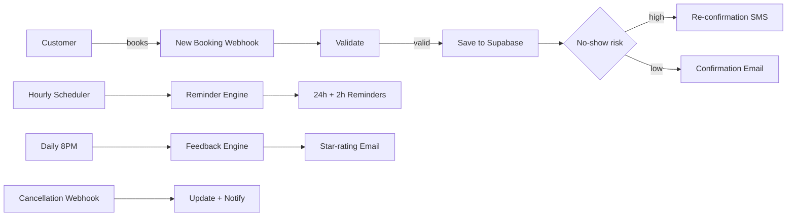

# SmartBook AI

> AI-powered booking automation platform with no-show prediction. Built end-to-end on n8n, Supabase, FastAPI, and Anthropic Claude.

[](LICENSE)
[]()
[]()
[]()

SmartBook automates the full appointment lifecycle for service businesses (salons, clinics, tutors, repair shops) and uses a trained classifier to predict no-show risk on every new booking, triggering proactive re-confirmation messages on the high-risk ones.

The whole system runs on a single n8n workflow with five interlocking pipelines, backed by a FastAPI microservice for ML inference and a Supabase database for persistence.

---

## Architecture



#### The actual workflow in n8n


> *24 nodes spanning all five pipelines — booking intake, payment-style validation, ML risk scoring, hourly reminder engine, cancellation handler, and daily feedback collector. Sensitive URLs and account identifiers have been redacted from this view.*

### Five workflow pipelines, one workflow file

| # | Pipeline | Trigger | What it does |
|---|---|---|---|
| 1 | **New Booking** | Webhook (`POST /booking`) | Validates, saves to Supabase, checks no-show risk, dispatches email + SMS |
| 2 | **Reminder Engine** | Cron (hourly) | Sends 24-hour and 2-hour pre-appointment reminders, never duplicates |
| 3 | **Cancellation** | Webhook (`POST /cancel`) | Updates booking status, notifies customer and business |
| 4 | **Feedback Engine** | Cron (daily 8PM) | Emails one-click star-rating links to completed appointments |
| 5 | **ML Risk Scoring** | HTTP call from pipeline 1 | FastAPI service scores no-show risk; risk ≥ 0.65 triggers re-confirmation SMS |

---

## Tech stack

**Orchestration** &middot; n8n (self-hosted or cloud)
**Database** &middot; Supabase (PostgreSQL) with Row-Level Security
**ML service** &middot; FastAPI + XGBoost classifier
**LLM** &middot; Anthropic Claude (for conversational booking)
**Messaging** &middot; Twilio SMS, SMTP email
**Hosting** &middot; Ubuntu VPS, Docker, ngrok (development), nginx (production)

---

## What's in this repo

```
smartbook-ai-automation/
├── README.md                      ← you are here
├── LICENSE                        ← MIT
├── SECURITY.md                    ← credential & secrets policy
├── .gitignore                     ← keeps secrets out
├── .env.example                   ← documents required environment variables
├── docs/
│   └── workflow.png               ← n8n workflow canvas screenshot
└── workflows/
    └── Smart_Book_AI.json         ← the complete n8n workflow (sanitized)
```

The workflow JSON is fully importable — every secret has been replaced with a `{{PLACEHOLDER}}` marker. The `.env.example` documents exactly what each placeholder maps to.

---

## How to run it locally

### Prerequisites

You'll need accounts (free tiers work for testing) with:

- [Supabase](https://supabase.com) — for the database
- [Twilio](https://twilio.com) — for SMS
- An SMTP provider (Gmail, SendGrid, Mailgun, etc.) — for email
- [Anthropic](https://console.anthropic.com) — for the conversational booking interface (optional)
- A running n8n instance ([self-hosted](https://docs.n8n.io/hosting/) or [n8n cloud](https://n8n.io/cloud/))

### Setup steps

**1. Set up the database**

In Supabase, create a `bookings` table with these columns:

| Column | Type | Notes |
|---|---|---|
| `id` | `uuid` | primary key, default `gen_random_uuid()` |
| `customer_name` | `text` | |
| `customer_email` | `text` | |
| `customer_phone` | `text` | E.164 format |
| `appointment_time` | `timestamptz` | |
| `service` | `text` | |
| `status` | `text` | default `'confirmed'` |
| `risk_score` | `float` | populated by ML service |
| `reminded_24h` | `boolean` | default `false` |
| `reminded_2h` | `boolean` | default `false` |
| `feedback_sent` | `boolean` | default `false` |
| `created_at` | `timestamptz` | default `now()` |

**2. Configure environment variables**

Copy `.env.example` to `.env` and fill in your real values. **Never commit `.env`.**

**3. Import the workflow**

In n8n: **Workflows → Import from File** → select `workflows/Smart_Book_AI.json`.

After import, you'll see placeholder warnings on each credential. Click each node that uses credentials and connect them to your actual n8n credentials (Supabase header auth, Twilio API, SMTP).

**4. Activate the workflow**

Toggle the workflow to **Active**. The webhook URLs become live and the cron triggers begin firing.

**5. Test it**

Send a test booking:

```bash
curl -X POST https://your-n8n-instance/webhook/booking \
  -H "Content-Type: application/json" \
  -d '{
    "customer_name": "Test User",
    "customer_email": "test@example.com",
    "customer_phone": "+1234567890",
    "appointment_time": "2026-06-01T15:00:00Z",
    "service": "Consultation"
  }'
```

You should receive a confirmation email within seconds.

---

## Engineering notes

A few decisions worth flagging for anyone reading the workflow:

**Idempotency on reminders.** The `reminded_24h` and `reminded_2h` flags are checked before sending and updated after. The hourly cron can fire multiple times in the reminder window without ever sending duplicate messages.

**ML drift protection.** The XGBoost model output is a probability between 0 and 1. The risk threshold (default 0.65) is configured in the workflow, not in the model — so retraining the model doesn't require redeploying logic.

**Failure observability.** Every HTTP node has a continue-on-fail path that logs to a separate Supabase table (`workflow_errors`) with the stage name, error message, and booking ID. Silent failures are the enemy of trust.

**Conversational layer.** The Claude-powered chatbot lives outside this workflow file — it's an upstream pre-processor that extracts structured booking data from natural language and then POSTs to the booking webhook just like a form submission would.

---

## Security

This repository contains **no live credentials**. Every secret in the workflow JSON is a placeholder (e.g. `{{SUPABASE_SERVICE_ROLE_KEY}}`).

See [`SECURITY.md`](SECURITY.md) for the full credential policy and what to do if you find anything that looks like it shouldn't be public.

---

## License

[MIT](LICENSE) — use this however you like.

---

## About

Built by **Olawale Emmanuel Olaonipekun** as a capstone for the Axia Africa AI Automation programme.

- Portfolio: [olawaleemmanuel09.github.io](https://olawaleemmanuel09.github.io)
- LinkedIn: [olawale-olaonipekun](https://www.linkedin.com/in/olawale-olaonipekun-0505303b4)
- X: [@LaoniAI](https://x.com/LaoniAI)

If you're building something in this space and want to talk, the contact details on the portfolio work.
