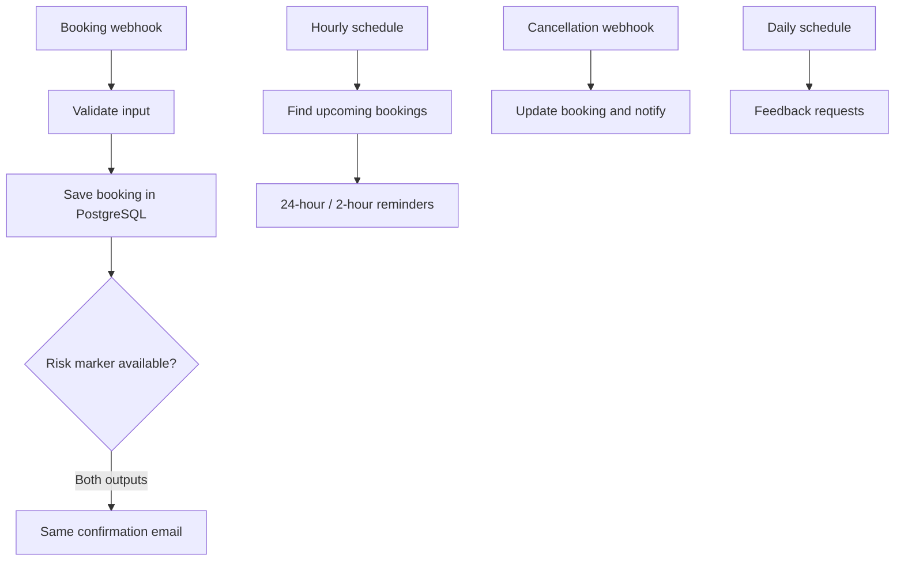

# SmartBook AI — Booking & No-Show Risk Workflow

**A practical appointment-operations system designed to reduce missed bookings through confirmation, reminders, cancellation handling and risk-aware follow-up.**

**Type:** Axia Africa capstone · **Role:** workflow and integration engineering · **Stack:** n8n, Supabase/PostgreSQL, Twilio, email; FastAPI/XGBoost inference as a separately documented integration concept.

## Business problem

A booking is not complete when a form is submitted. Staff need accurate appointment records, customers need timely reminders, and changes must reach the right people. SmartBook explores that end-to-end lifecycle and where predictive scoring could improve follow-up prioritization.

## What is actually in this repository

- [`Smart_Book_AI.json`](Smart_Book_AI.json): **24-node** n8n export with booking intake, validation, Supabase persistence, hourly reminder scheduling, cancellation and feedback branches.
- [`workflow.png`](workflow.png): visual overview of the workflow.
- [`env.example`](env.example): configuration reference.
- [`SECURITY.md`](SECURITY.md): sensitive-information handling.

Both outputs of the high-risk decision lead to the same confirmation email. The export references a risk marker but **does not contain a FastAPI/XGBoost inference server or a model-training/evaluation pipeline**. The README therefore describes risk prediction as an *integration boundary*, not a fully reproducible ML implementation. The exported workflow is inactive by default; live deployment is not established by this repository.

## Architecture

## Engineering decisions

**Separate the booking record from messaging.** The booking state belongs in a database; an email or SMS is a delivery attempt, not the source of truth.

**Use scheduled reminders with state flags.** The template checks reminder flags to reduce repeat messages. A production version would need atomic reservation/claiming and provider-message idempotency to handle crashes and concurrent executions safely; the current export does not establish an exactly-once guarantee.

**Treat prediction as an advisory signal.** A no-show score can influence follow-up priority. It must not autonomously cancel a booking or invent a payment status. Model quality must be measured on real, consented data before deployment.

**Keep failures observable.** Future production hardening should add a durable delivery log, explicit retry/backoff, provider error reconciliation and alerting. Do not infer that these are fully implemented merely because a workflow has error branches.

## Demo walkthrough

1. Submit a synthetic booking and inspect the saved record.
2. Trigger or simulate the due-reminder path in a test environment.
3. Cancel the booking; verify the stored status and notification behavior.
4. Show how a future FastAPI risk endpoint would return a validated score.
5. Explain the concurrency/idempotency improvements required before real customer traffic.

No real patient, customer or payment information should be committed. The workflow needs your own credentials and test services to run.

## What this demonstrates

I can model business processes as stateful workflows, integrate APIs and data storage, handle operational edge cases, and distinguish a compelling AI prototype from a production-certified system.

**Portfolio:** https://olawaleolaonipekun.vercel.app
